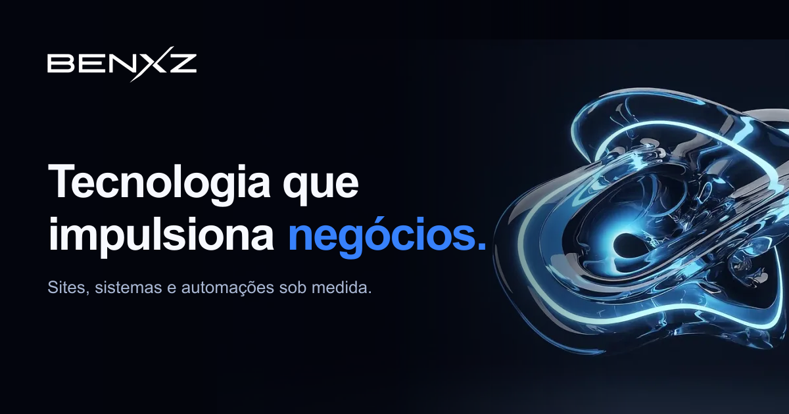

# Murilo Benitez Proença

Tenho **19 anos**, sou de **Curitiba (PR)** e curso **Engenharia de Software na PUCPR**. Sou CEO e cofundador da **BENXZ**. Minha trajetória também inclui experiência na **RPC**. [Meu LinkedIn](https://www.linkedin.com/in/murilo-benitez-proen%C3%A7a-9385912a8/)

 Gosto de começar pelo trabalho que alguém faz todo dia. Quando uma equipe precisa procurar a última conversa no WhatsApp, conferir uma planilha e lembrar de cabeça quem espera uma proposta, já existe um bom problema de software para resolver.

## Dois projetos que mostram como eu trabalho

**Um CRM para a rotina comercial.** Desenvolvi uma aplicação local em Python e SQLite que reúne empresas, histórico de contatos, propostas e próximas ações. A tela *Meu dia* ajuda a decidir quem precisa de retorno. O Kanban mostra em que etapa está cada negociação. Escolhi HTML, CSS e JavaScript para que a interface também funcione offline.

**Um site em que a rolagem controla a cena.** No site da BENXZ, uma escultura azul acompanha o movimento da página. A animação usa quadros WebP desenhados em canvas, com versões menores para celular. A escolha mantém a identidade visual da marca e permite apresentar os serviços mesmo quando o visitante prefere movimento reduzido.

<strong>Ver a escultura e os bastidores da animação</strong>

O ponto de partida foi um vídeo. No navegador, o código escolhe os quadros de acordo com a posição da página e mistura quadros vizinhos para suavizar o movimento. A versão estática usa um pôster da mesma sequência.

## Minha bancada

| Área | O que faço |
| --- | --- |
| **Interfaces** | Sites e aplicações responsivas com React, Next.js, TypeScript, HTML e CSS. |
| **Dados e sistemas** | Modelagem relacional, consultas SQL, persistência em SQLite e desenvolvimento com Python, JavaScript e PHP. |
| **Integrações** | Conecto APIs e planilhas, testo requisições no Postman e automatizo tarefas repetitivas. |
| **Entrega** | Versiono com Git, reviso mudanças no GitHub e verifico o build antes de preparar uma versão. |

## BENXZ · Tecnologia que impulsiona negócios

Na BENXZ, desenvolvemos landing pages, sites profissionais, mini-CRMs, sistemas sob medida e automações. Também avaliamos aplicações de IA quando existe uma tarefa concreta que justifique seu uso.

Se quiser conversar sobre um projeto, comece pelo que sua equipe faz hoje. **Qual tarefa ainda depende de copiar dados de um lugar para outro?**

[Conversar com a BENXZ no WhatsApp](https://wa.me/5541998368264)
